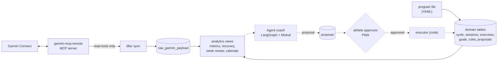
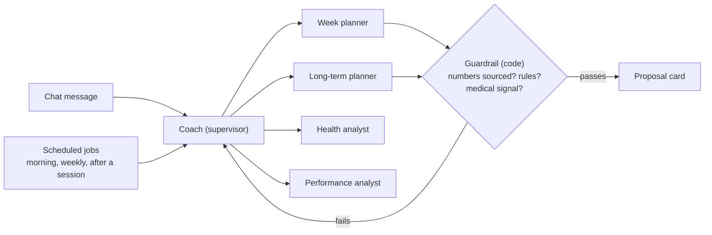

# Lifter

[](https://github.com/gabrielkpo/lifter/actions/workflows/ci.yml)
[](LICENSE)

A **CrossFit** coaching app for athletes who wear a Garmin watch, where the coach is a team
of agents (**LangGraph + Mistral**, Garmin through the **Model Context Protocol**). It follows
one method: a three-month cycle in three blocks, sessions in a fixed frame (weightlifting or
gymnastics, strength, metcon), every movement prescribed with a target RIR, and every week
programmed from the review of the last one and from the watch's recovery data. Agents only
propose; nothing changes without the athlete's **approval**.

> **Status: data layer and CrossFit domain done, first agent in progress, built in public.**
> Garmin sync, documented metrics, the training cycle, sessions (planned and logged), goals and
> proposals work from the command line; the week planner agent programs a week in dry run. See [Status / Roadmap](#status--roadmap). Expect breaking changes until `v0.1.0`.

## Why
Programming CrossFit well is a weekly chore: review what was done (loads, RIR, skipped
sessions, pain), check recovery, then write next week within the cycle's phase and the
athlete's constraints. A Garmin watch measures recovery but knows nothing of the program; a
training log knows the program but not the body. Lifter puts both in one place and gives the
weekly programming to an agent coach, which explains every proposal with numbers traced to a
documented metric or to the log.

| Module | What the athlete does |
|---|---|
| Calendar | Sees planned and done sessions with their Garmin line, moves, adds or cancels them |
| Coach (chat) | "Program next week", "move Thursday's legs", "why this load?"; each action comes back as a card to approve |
| Long term | The cycle: blocks, weekly phases, deloads, test week; when to move to the next block |
| Goals and bests | Loads and skills per block (bench, power clean, first bar muscle-up), benchmark metcons, best logged loads |
| Health and feedback | Recovery, sleep, HRV, resting HR, Body Battery, alerts; RPE and pain after each session |

## How it works
Built parts are solid, planned ones dashed:



Target agent team (steps 3 to 6):



Choices and their trade-offs:
- **Agents never write.** They create typed proposals; code validates them, the athlete
  approves, code applies them once. Fewer surprises, at the cost of one tap per change.
- **A supervisor with specialists rather than one agent with every tool.** One agent choosing
  among many tools tends to choose poorly; the bench will check this against a single agent.
- **Plain SQL views rather than dbt.** Every line is readable and pinned by hand-computed
  tests; views live in an `analytics` schema recreated when `views.sql` changes.
- **Agents read numbers, they never compute them.** Metrics are defined once in
  [docs/metrics.md](docs/metrics.md), the domain in [docs/domain.md](docs/domain.md); the
  athlete's rules (no running, no free barbell on the legs, load up only when the RIR is met)
  run as code in the guardrail, not as prompt text.
- **One sport, one method.** Scoping to CrossFit gives sessions a fixed frame and the coach a
  clear job (program next week); a generic multi-sport planner would be vaguer and harder to
  evaluate.

## Example
`lifter metrics --days 14` on 56 days of **synthetic** data with a hard last week, not real
data (regenerate it with [scripts/readme_example.py](scripts/readme_example.py)), last 6 rows:

```
day         load   acute_load_7d  chronic_load_28d  acwr  hrv_delta_pct  rhr_delta_bpm  sleep_hours  recovery_score  recovery_status  trend
2026-09-22  150.0  495.0          450.0             1.10  1.6            -1.0           7.14         62              normal           stable
2026-09-23  110.0  530.0          458.8             1.16  1.8            -1.0           6.57         56              normal           stable
2026-09-24  130.0  540.0          472.5             1.14  -20.1          1.0            8.08         47              normal           improving
2026-09-25  130.0  670.0          505.0             1.33  -6.5           3.0            7.09         41              normal           improving
2026-09-26  110.0  705.0          502.5             1.40  -22.4          2.9            7.36         33              low              fatigue
2026-09-27  130.0  760.0          505.0             1.50  -3.6           2.8            7.42         48              normal           fatigue
```

On 26 September, HRV is 22 % under the athlete's baseline (`hrv_drop` alert), recovery is `low`
and the trend turns to `fatigue`: the coach must propose a lighter week.

## Status / Roadmap
Each step lands as a reviewed pull request with green CI.

| # | Step | Status |
|---|---|---|
| 1 | Garmin sync, metrics, recovery and form | ✅ Done |
| 2 | CrossFit domain: cycle, blocks and weeks, sessions in parts (planned and logged), exercise bank, goals, rules, proposals; program file loader | ✅ Done |
| 3 | Agent coach v1 from the command line: programs next week from the week review and the phase, dry-run, guardrail, audit log; release `v0.1.0` | 🔨 Week planner and guardrail done ([docs/agents.md](docs/agents.md)) |
| 4 | FastAPI + responsive PWA: calendar, session log, chat, health, goals; approval cards | Planned |
| 5 | Optional: push approved sessions to the Garmin calendar | Planned |
| 6 | Long term (block transitions, test week) and scheduled jobs (morning, weekly, after a session), notifications | Planned |
| 7 | Evaluation bench: single agent vs agent team | Planned |
| 8 | Two deployments: public demo (synthetic athletes, replayed runs, full ops pipeline) and private personal instance | Planned |
| 9 | Results write-up | Planned |

**Evaluation plan** (written before any run): 20 synthetic scenarios so far
([docs/bench.md](docs/bench.md): deload, return after a deload, skipped sessions, RIR missed on
the main lift, knee pain, low recovery, critical alerts, drafts already planned), each with its
expected outcome written first. Floor to beat, without a model ("copy last week"): 67 % of the
expectations met. Measures: constraint violations, accuracy of cited numbers, plan quality
graded by hand, tokens, latency, variance over 3 runs. The agent team is kept only if it has
**no constraint violation**, cites numbers **at least as accurately** as a single agent with
every tool, and costs **at most 2×** its tokens; otherwise this README reports the negative result.

## Run it
Needs [uv](https://docs.astral.sh/uv/) (it installs Python 3.12 if missing), a local Postgres 17
and a running [garmin-mcp-remote](https://github.com/gabrielkpo/garmin-mcp-remote), reached on the
loopback or a private network; its bearer token goes in `.env`.

```bash
cp .env.example .env               # then set GARMIN_MCP_TOKEN
createdb lifter
uv sync
uv run lifter sync --days 90       # creates or updates the schema, then syncs (read-only)
uv run lifter program load examples/program.yaml   # or your own program, kept in data/
uv run lifter weeks                # also: program, week N, session ID, calendar, goals, bests
uv run lifter plan-week            # the week planner agent, dry run (needs MISTRAL_API_KEY)
```

Also: `metrics`, `recovery`, `exercises`, `session-add`, `session-move`, `session-cancel`,
`goal-add`, `feedback --rpe 7`, `proposals`, `proposal approve|reject ID`.

## App
A mobile-first web app, installable as a PWA (Next.js, `web/`), over a private, read-only HTTP
API (FastAPI, `src/lifter/api/`). The API reads the same analytics views as the CLI and
computes nothing of its own. Five tabs: **WOD** (the week, day by day, and each session planned
against done), **PRs** (best loads by kind and family), **Coach** (chat, with the agents),
**Planning** (cycle, blocks counted in strength sessions, weeks, goals) and **Health** (recovery
read against the sessions of each day); the profile opens from the avatar.

```bash
uv run lifter-api                  # http://127.0.0.1:8000, interactive docs at /docs
cd web && npm ci && npm run dev    # http://localhost:3000
```

| Endpoint | Screen |
|---|---|
| `GET /weeks/current`, `/weeks`, `/weeks/{id}` | The week: review, intent, sessions with status and Garmin line |
| `GET /sessions/{id}` | A session: parts, planned and done side by side, metcon target and result |
| `GET /calendar?start=&end=` | Sessions and activities between two days |
| `GET /program` | Cycle and blocks, strength sessions done against the block target |
| `GET /health?days=14` | Daily metrics, Garmin recovery values and alerts |
| `GET /goals`, `/bests` | Goals with milestones, best logged loads |
| `GET /proposals?status=pending` | The agents' proposals |

The API has no authentication yet, so it only listens on `127.0.0.1` and opens its database
connection read-only; only the app origins in `LIFTER_APP_ORIGINS` may call it from a browser.

## Project structure
| Path | Content |
|---|---|
| `src/lifter/cli.py` | Command-line entry point |
| `src/lifter/api/` | Read-only HTTP API of the app (FastAPI) |
| `web/` | The app: Next.js PWA, mobile first |
| `src/lifter/garmin.py`, `sync.py` | MCP client (read-only allowlist), Garmin to raw layer |
| `src/lifter/domain.py`, `program.py` | Sessions in parts, exercises, goals, rules, proposal lifecycle; program file loader |
| `examples/program.yaml` | Synthetic CrossFit program, every field of the format |
| `src/lifter/db.py`, `sql/` | Migrations (tables) and `views.sql` (analytics schema) |
| `src/lifter/agents/` | Week planner: context, typed plan, Mistral call, guardrail, LangGraph graph |
| `src/lifter/bench/`, `bench/` | Evaluation bench: synthetic athlete, scenarios, expectations, runner, results |
| `docs/metrics.md`, `docs/domain.md`, `docs/agents.md`, `docs/bench.md` | Every metric, threshold, table and status; the agents and their guardrail |
| `tests/` | pytest on synthetic data, against a throwaway Postgres database |

## Data and privacy
- **In the repository**: code, definitions and synthetic data only; `data/` and `.env` are
  ignored; gitleaks scans every pull request.
- **Never in the repository**: the athlete's Garmin data, program, rules, log and feedback;
  they stay in the local Postgres database and in `data/`.
- **Sent to a third party**: calls to the athlete's own MCP server, never exposed without
  authentication, and the agents' context to Mistral: the structured log and computed
  indicators, no free text by default, never raw series nor activity names (they can contain a
  place). See [docs/agents.md](docs/agents.md#what-is-sent-to-mistral).
- **Two instances**: the personal one on the athlete's data; the public demo only replays runs
  on synthetic athletes. Visitors never connect a Garmin account or enter a key.
- **No medical advice**: unusual signals raise `critical` alerts that block intense plans and
  point to a health professional.

## Limitations / next
- Thresholds are version 1 training heuristics for one athlete, to be tuned with the bench.
- Baselines need 14 measured nights and the load ratio 28 days: a new athlete waits two weeks.
- A session is matched to the day's training activities by order; an activity Lifter does not
  count as training (e.g. outdoor cycling) never completes a session.
- Until the app exists, the log is written in the program file and reloaded with `--replace`.
- The sync runs on demand; daily scheduling is not automated.

## Development
```bash
uv sync --group dev
uv run pre-commit install         # ruff (locked version) and gitleaks before each commit
uv run pytest                     # needs a local Postgres (TEST_DATABASE_URL)
```
Pull requests use Conventional Commits titles, go through a security review and a code review
before opening, and need green tests, gitleaks and PR title checks. Releases start at `v0.1.0`.

## License
[MIT](LICENSE)
