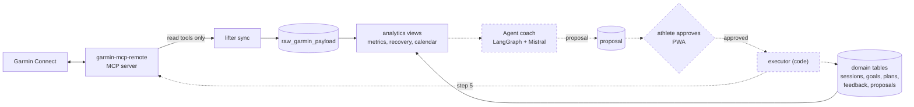
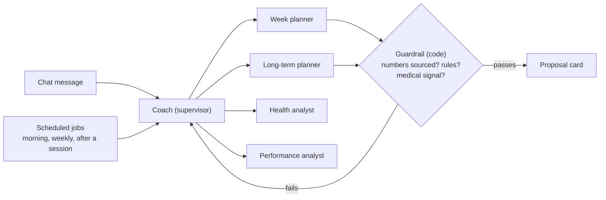

# Lifter

[](https://github.com/gabrielkpo/lifter/actions/workflows/ci.yml)
[](LICENSE)

A coaching app for athletes who wear a Garmin watch, where the coach is a team of agents
(**LangGraph + Mistral**, Garmin through the **Model Context Protocol**): one calendar for every
session, a chat to plan and move them, long-term planning toward goals, records, health and
feedback. Agents only propose; nothing changes, in Lifter or in Garmin, without the athlete's
**approval**.

> **Status: data layer and domain model done, built in public.** Garmin sync, documented
> metrics, calendar, goals, plans, feedback and proposals work from the command line; the
> agents come next. See [Status / Roadmap](#status--roadmap). Expect breaking changes until `v0.1.0`.

## Why
Coaching apps link a human coach to an athlete; a Garmin watch measures hundreds of things a
day. Lifter puts an agent coach in between: it reads the watch's data together with what the
watch is not told (injuries, preferred exercises, availability, how a session felt), plans the
weeks toward a goal, adapts them to recovery, and explains every proposal with numbers traced
to a documented metric.

| Module | What the athlete does |
|---|---|
| Calendar | Sees planned and done sessions, moves, adds or cancels them |
| Coach (chat) | "Plan my week", "move Thursday's ride", "why this session?"; each action comes back as a card to approve |
| Long term | Goal → training cycles, deload and taper weeks |
| Goals and records | Dated targets, Garmin personal records, progress |
| Health and feedback | Recovery, sleep, HRV, resting HR, Body Battery, alerts; RPE, fatigue and pain after each session |

## How it works
Built parts are solid, planned ones dashed:



Target agent team (steps 3 to 6):



Choices and their trade-offs:
- **Agents never write.** They create typed proposals; code validates them, the athlete
  approves, code applies them once. Fewer surprises, at the cost of one tap per change.
- **A supervisor with specialists rather than one agent with every tool.** One agent choosing
  among many tools tends to choose poorly; the bench will check this against a single agent.
- **Plain SQL views rather than dbt.** Every line is readable and pinned by hand-computed
  tests; views live in an `analytics` schema recreated when `views.sql` changes.
- **Agents read numbers, they never compute them.** Metrics are defined once in
  [docs/metrics.md](docs/metrics.md); business rules (no hard session on low recovery, weekly
  load increase of 10 % at most) run as code, not as prompt text.

## Example
`lifter metrics --days 14` on 56 days of **synthetic** data with a hard last week, not real
data (regenerate it with [scripts/readme_example.py](scripts/readme_example.py)), last 6 rows:

```
day         load   acute_load_7d  chronic_load_28d  acwr  hrv_delta_pct  rhr_delta_bpm  sleep_hours  recovery_score  recovery_status  trend
2026-09-22  150.0  495.0          450.0             1.10  1.6            -1.0           7.14         62              normal           stable
2026-09-23  110.0  530.0          458.8             1.16  1.8            -1.0           6.57         56              normal           stable
2026-09-24  130.0  540.0          472.5             1.14  -20.1          1.0            8.08         47              normal           improving
2026-09-25  130.0  670.0          505.0             1.33  -6.5           3.0            7.09         41              normal           improving
2026-09-26  110.0  705.0          502.5             1.40  -22.4          2.9            7.36         33              low              fatigue
2026-09-27  130.0  760.0          505.0             1.50  -3.6           2.8            7.42         48              normal           fatigue
```

On 26 September, HRV is 22 % under the athlete's baseline (`hrv_drop` alert), recovery is `low`
and the trend turns to `fatigue`: the coach must propose a lighter week.

## Status / Roadmap
Each step lands as a reviewed pull request with green CI.

| # | Step | Status |
|---|---|---|
| 1 | Garmin sync, metrics, recovery and form | ✅ Done |
| 2 | Domain: sessions, goals, plans, feedback, proposals; Garmin calendar, records and goals | ✅ Done |
| 3 | Agent coach v1 (supervisor + specialists) from the command line, dry-run, audit log; release `v0.1.0` | ⏳ Next |
| 4 | FastAPI + responsive PWA: calendar, chat, health, feedback, goals; approval cards | Planned |
| 5 | Approved writes to Garmin: schedule, move, remove sessions | Planned |
| 6 | Long-term planning and scheduled jobs (morning, weekly, after a session), notifications | Planned |
| 7 | Evaluation bench: single agent vs agent team | Planned |
| 8 | Two deployments: public demo (synthetic athletes, replayed runs, full ops pipeline) and private personal instance | Planned |
| 9 | Results write-up | Planned |

**Evaluation plan** (written before any run): 20 to 40 synthetic scenarios (overload, low
recovery, return after injury, race goal, "move my session" requests), each with its expected
outcome written first. Measures: constraint violations, accuracy of cited numbers, plan quality
graded by hand, tokens, latency, variance over 3 runs. The agent team is kept only if it has
**no constraint violation**, cites numbers **at least as accurately** as a single agent with
every tool, and costs **at most 2×** its tokens; otherwise this README reports the negative result.

## Run it
Needs [uv](https://docs.astral.sh/uv/) (it installs Python 3.12 if missing), a local Postgres 17
and a running [garmin-mcp-remote](https://github.com/gabrielkpo/garmin-mcp-remote), reached on the
loopback or a private network; its bearer token goes in `.env`.

```bash
cp .env.example .env               # then set GARMIN_MCP_TOKEN
createdb lifter
uv sync
uv run lifter sync --days 90       # creates or updates the schema, then syncs (read-only)
uv run lifter calendar             # also: metrics, recovery, records, goals, proposals
```

Plan by hand meanwhile: `lifter session-add 2026-11-02 cycling "Long ride"`, `session-move`,
`session-cancel`, `goal-add`, `feedback --rpe 7`, `proposal approve|reject ID`.

## Project structure
| Path | Content |
|---|---|
| `src/lifter/cli.py` | Command-line entry point |
| `src/lifter/garmin.py`, `sync.py` | MCP client (read-only allowlist), Garmin to raw layer |
| `src/lifter/domain.py` | Sessions, goals, plans, feedback, proposal lifecycle |
| `src/lifter/db.py`, `sql/` | Migrations (tables) and `views.sql` (analytics schema) |
| `docs/metrics.md`, `docs/domain.md` | Every metric, threshold, table and status |
| `tests/` | pytest on synthetic data, against a throwaway Postgres database |

## Data and privacy
- **In the repository**: code, definitions and synthetic data only; `data/` and `.env` are
  ignored; gitleaks scans every pull request.
- **Never in the repository**: the athlete's Garmin data, profile, plans or feedback; they stay
  in the local Postgres database.
- **Sent to a third party**: today nothing but calls to the athlete's own MCP server, never
  exposed without authentication. From step 3 the agents send Mistral the computed indicators
  they need, never raw series nor activity names (they can contain a place).
- **Two instances**: the personal one on the athlete's data; the public demo only replays runs
  on synthetic athletes. Visitors never connect a Garmin account or enter a key.
- **No medical advice**: unusual signals raise `critical` alerts that block intense plans and
  point to a health professional.

## Limitations / next
- Thresholds are version 1 training heuristics for one athlete, to be tuned with the bench.
- Baselines need 14 measured nights and the load ratio 28 days: a new athlete waits two weeks.
- An activity started with the watch's stopwatch has no sport: it cannot match a planned session.
- The sync runs on demand; daily scheduling is not automated.

## Development
```bash
uv sync --group dev
uv run pre-commit install         # ruff (locked version) and gitleaks before each commit
uv run pytest                     # needs a local Postgres (TEST_DATABASE_URL)
```
Pull requests use Conventional Commits titles, go through a security review and a code review
before opening, and need green tests, gitleaks and PR title checks. Releases start at `v0.1.0`.

## License
[MIT](LICENSE)
