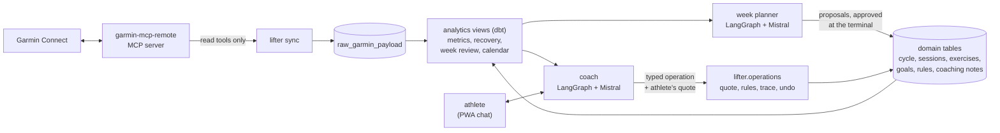
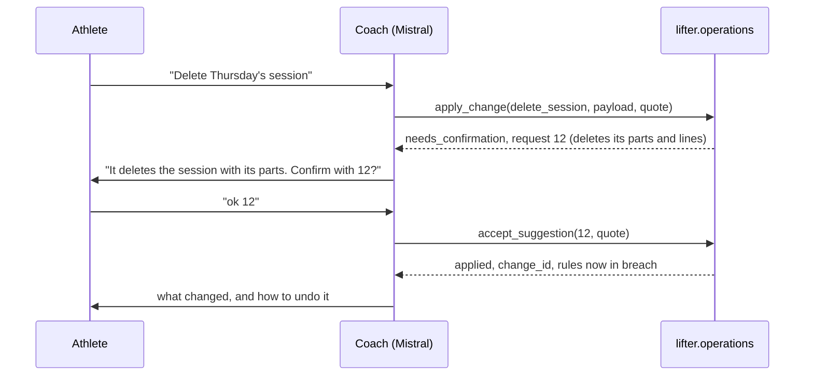

# Lifter

[](https://github.com/gabrielkpo/lifter/actions/workflows/ci.yml)
[](https://github.com/gabrielkpo/lifter/releases)
[](LICENSE)

A **CrossFit** coaching app for athletes who wear a Garmin watch, where the coach is an agent
(**LangGraph + Mistral**, Garmin through the **Model Context Protocol**) that the athlete talks
to: every change it makes quotes the athlete's own message, is checked by code, traced and
reversible, and a destructive change waits for the athlete's confirmation.

> **Status: in use, built in public.** Data layer, domain, app and the coach in conversation run
> in production for one athlete; the week planner runs from the command line. The agent team and
> the long term are next.
> See [Status / Roadmap](#status--roadmap). Expect breaking changes before `v1.0.0`.

## Why
Programming CrossFit well is a weekly chore: review what was done (loads, RIR, skipped
sessions, pain), check recovery, then write next week within the cycle's phase and the
athlete's constraints. A Garmin watch measures recovery but knows nothing of the program; a
training log knows the program but not the body. Lifter puts both in one place and lets the
athlete program and adjust it by talking to a coach that cites the log and the metrics.

## How it works
The data path, from the watch to the coach:



The coach's write path, for one athlete message:



Choices and their trade-offs:
- **The athlete's words are the authority, checked by code, not the model's reading.** Every
  write is a typed operation that quotes the athlete's latest message, word for word. A quote
  only proves the words exist, so destructive operations and changes that break the athlete's
  rules take a second, numbered confirmation; the rest applies at once and can be undone
  ([ADR 0002](docs/adr/0002-coach-write-path-and-agent-team.md)). The price: one more message
  for risky changes.
- **Agents read numbers, they never compute them.** Metrics are defined once
  ([docs/metrics.md](docs/metrics.md)) and computed in dbt views with contracts and data tests
  ([ADR 0001](docs/adr/0001-dbt-for-the-analytics-layer.md)); the athlete's coded rules run in a
  guardrail, not as prompt text.
- **The method is data.** The cycle, blocks and weeks carry their intent, and the athlete's
  method lives in coaching notes the coach reads and edits with them, not in the prompt.
- **One agent first, a team later, measured.** The agent team (planners, analysts) is designed
  in ADR 0002 and must beat the single agent on the bench before it ships.

## Example
A bench scenario on a synthetic athlete whose rule forbids a free barbell on the legs
(`bench/conversations/forbidden_exercise.yaml`, run in French, translated and shortened here):

```
athlete> Add back squat 5x5 at 80 kg to this week's Legs + Metcon session.
coach>   That breaks your rule "No free barbell on the legs", so it waits for you:
         confirm with 1, or I can suggest a leg press instead.
athlete> Yes, I confirm.
coach>   Added back squat 5x5 at 80 kg to Friday's Legs + Metcon. It breaks
         "No free barbell on the legs"; undo it from this message if needed.
```

## Results
Measured with Mistral on synthetic scenarios ([docs/bench.md](docs/bench.md)); each figure is
the summary of a committed run file in `bench/results/`.

| Bench | Configuration | Runs | Result |
|---|---|---|---|
| Week planner, 21 scenarios | Floor: copy last week, no model | 21 | 71 % plans accepted, 66 % expectations met |
| | Single agent, `mistral-small-latest` | 105 | 88 % accepted, 80 % expectations met |
| Coach in conversation, 15 scenarios | `mistral-small-latest` | 45 | 39 fully met (87.5 % expectations) |
| | `mistral-medium-latest` | 45 | 42 fully met (95.8 %) |
| Coach, current code, 22 scenarios | Floor: a coach that never calls a tool | 22 | 6 fully met (43 %) |
| | `mistral-medium-latest` (default) | 66 | 65 fully met (98.1 %) |

Read with care: the coach's prompt was tuned on these same scenarios (no held-out set yet), each
rate rests on 3 to 5 runs per scenario without an interval, and `-latest` model aliases move.

## Run it
Needs [uv](https://docs.astral.sh/uv/), a local Postgres 18, a running
[garmin-mcp-remote](https://github.com/gabrielkpo/garmin-mcp-remote) (its token in `.env`) and,
for the agents, a `MISTRAL_API_KEY`.

```bash
cp .env.example .env                                # then set GARMIN_MCP_TOKEN and MISTRAL_API_KEY
createdb lifter
uv run lifter sync --days 90                        # creates the schema, then syncs (read-only on Garmin)
uv run lifter program load examples/program.yaml    # a synthetic CrossFit program
uv run lifter chat "Move Thursday's session to Friday"
```

Every command: `uv run lifter --help`. The app (Node 22.18+): [docs/app.md](docs/app.md).

## Project structure
| Path | Content |
|---|---|
| `src/lifter/` | CLI, Garmin sync (read-only MCP allowlist), domain, operations catalogue, migrations and roles (`sql/`) |
| `src/lifter/transform/` | Analytics layer: dbt models, data tests, contracts |
| `src/lifter/agents/`, `bench/` | Week planner and coach (LangGraph + Mistral, guardrail), their scenarios and results |
| `src/lifter/api/`, `api/` | HTTP API (FastAPI, on Vercel): reads, and the conversation with the coach |
| `web/` | The Next.js PWA: five tabs, the coach's chat, its own sign-in |
| `ops/` | Scheduled jobs on the athlete's Mac: sync, backups, restore test |
| `docs/` | Metrics, domain, agents, bench, app, operations, decisions (`adr/`) |

## Data and privacy
- **In the repository**: code, definitions and synthetic data only; `data/` and `.env` are
  ignored; gitleaks scans every pull request.
- **Never in the repository**: the athlete's Garmin data, program, rules, log, profile and
  health; they live in the database (Neon, Frankfurt, least-privilege roles) and in `data/`.
- **Sent to Mistral by the week planner**: the structured log, indicators and the programme's
  text (titles, intents, rules, goals, pain locations); notes and reviews only with
  `LIFTER_LLM_CONTEXT=full`.
- **Sent to Mistral by the coach, always**: the conversation, this week's and next week's
  sessions, the programme with its week reviews, the coaching notes, open health issues with
  their descriptions, and the rows it reads with its tools.
  [docs/agents.md](docs/agents.md#what-is-sent-to-mistral) has the detail.
- **One private instance** today; a public demo on synthetic athletes is planned (step 8).
- **No medical advice**: unusual signals raise alerts that point to a health professional.

## Limitations / next
- The coach's figures are in-sample (see Results); a held-out scenario set comes before the next
  prompt change.
- A coach turn sends about 10,000 tokens per model call and may stop at its 60,000-token budget
  after six calls; prompt caching and a lighter snapshot are next.
- Thresholds are version 1 heuristics for one athlete; baselines need 14 measured nights.
- One athlete per instance: sign-in by email and per-athlete data isolation are a later step.
- The sync, the backup and the restore test run on the athlete's Mac
  ([docs/operations.md](docs/operations.md)): no sync while the Mac is off.

## Status / Roadmap
| # | Step | Status |
|---|---|---|
| 1 | Garmin sync, metrics, recovery and form | ✅ Done |
| 2 | CrossFit domain: cycle, blocks, weeks, sessions in parts, exercise bank, goals, rules | ✅ Done |
| 3 | Week planner agent, guardrail, audit log | ✅ Done ([docs/agents.md](docs/agents.md)) |
| 4 | App (API + PWA, hosted) and the coach in conversation | ✅ Done ([docs/app.md](docs/app.md)) |
| 5 | Optional: push sessions to the Garmin calendar | Planned |
| 6 | Agent team: cycle and week planners, analysts; long term, test week | 🔨 Designed (ADR 0002), first pieces in the coach |
| 7 | Evaluation bench: single agent vs agent team | 🔨 Bench running ([docs/bench.md](docs/bench.md)); comparison when the team exists |
| 8 | Public demo on synthetic athletes | Planned |
| 9 | Results write-up | Planned |

## Development
```bash
uv sync --group dev
uv run pre-commit install         # ruff (locked version) and gitleaks before each commit
uv run pytest                     # needs a local Postgres 18 (TEST_DATABASE_URL)
```
The code is written with an AI coding agent under the owner's direction. Each pull request has a
Conventional Commits title and goes through an automated security review and code review, whose
findings and fixes are in its description; CI must be green and the owner merges. Releases come
from release-please's pull request.

## License
[MIT](LICENSE)
