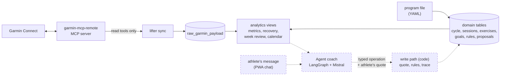

# Lifter

[](https://github.com/gabrielkpo/lifter/actions/workflows/ci.yml)
[](LICENSE)

A **CrossFit** coaching app for athletes who wear a Garmin watch, where the coach is a team
of agents (**LangGraph + Mistral**, Garmin through the **Model Context Protocol**). It follows
one method: a three-month cycle in three blocks, sessions in a fixed frame (weightlifting or
gymnastics, strength, metcon), every movement prescribed with a target RIR, and every week
programmed from the review of the last one and from the watch's recovery data. The athlete
talks to the coach; nothing changes unless **the athlete's own words**, checked by code, ask for it.

> **Status: built in public.** Data layer, CrossFit domain and the app are done and hosted; the
> week planner runs in dry run; the coach in conversation is next. See
> [Status / Roadmap](#status--roadmap). Expect breaking changes until `v0.1.0`.

## Why
Programming CrossFit well is a weekly chore: review what was done (loads, RIR, skipped
sessions, pain), check recovery, then write next week within the cycle's phase and the
athlete's constraints. A Garmin watch measures recovery but knows nothing of the program; a
training log knows the program but not the body. Lifter puts both in one place and gives the
weekly programming to an agent coach, which explains every proposal with numbers traced to a
documented metric or to the log.

It covers the calendar (planned and done sessions with their Garmin line), the coach in
conversation, the long term (blocks, deloads, test week), goals and best loads, and health
(recovery, sleep, HRV, alerts, pain after each session).

## How it works
Built parts are solid, planned ones dashed:



The agent team behind the coach (supervisor, week and long-term planners, health and performance
analysts) is designed in [ADR 0002](docs/adr/0002-coach-write-path-and-agent-team.md).

Choices and their trade-offs:
- **The athlete's words are the approval, checked by code.** The coach writes only through typed
  operations; each must quote the athlete's message, verified word for word, passes the rules
  and is traced and reversible ([ADR 0002](docs/adr/0002-coach-write-path-and-agent-team.md)).
- **A supervisor with specialists rather than one agent with every tool.** One agent choosing
  among many tools tends to choose poorly; the bench will check this against a single agent.
- **dbt for the analytics layer, as views.** Not for the volume (a few MB) but for guarantees on
  the numbers the agents cite: contracts, data tests on the real data, lineage
  ([ADR 0001](docs/adr/0001-dbt-for-the-analytics-layer.md)).
- **Agents read numbers, they never compute them.** Metrics are defined once in
  [docs/metrics.md](docs/metrics.md), the domain in [docs/domain.md](docs/domain.md); the
  athlete's rules (no running, no free barbell on the legs, load up only when the RIR is met)
  run as code in the guardrail, not as prompt text.
- **One sport, one method.** CrossFit gives sessions a fixed frame and the coach a clear job; a
  multi-sport planner would be vaguer and harder to evaluate.

## Example
`lifter metrics --days 14` on **synthetic** data with a hard last week
([scripts/readme_example.py](scripts/readme_example.py)), last 6 rows:

```
day         load   acute_load_7d  chronic_load_28d  acwr  hrv_delta_pct  rhr_delta_bpm  sleep_hours  recovery_score  recovery_status  trend
2026-09-22  150.0  495.0          450.0             1.10  1.6            -1.0           7.14         62              normal           stable
2026-09-23  110.0  530.0          458.8             1.16  1.8            -1.0           6.57         56              normal           stable
2026-09-24  130.0  540.0          472.5             1.14  -20.1          1.0            8.08         47              normal           improving
2026-09-25  130.0  670.0          505.0             1.33  -6.5           3.0            7.09         41              normal           improving
2026-09-26  110.0  705.0          502.5             1.40  -22.4          2.9            7.36         33              low              fatigue
2026-09-27  130.0  760.0          505.0             1.50  -3.6           2.8            7.42         48              normal           fatigue
```

On 26 September, HRV is 22 % under the athlete's baseline (`hrv_drop` alert), recovery is `low`
and the trend turns to `fatigue`: the coach must propose a lighter week.

## Status / Roadmap
Each step lands as a reviewed pull request with green CI.

| # | Step | Status |
|---|---|---|
| 1 | Garmin sync, metrics, recovery and form | ✅ Done |
| 2 | CrossFit domain: cycle, blocks, weeks, sessions in parts, exercise bank, goals, rules | ✅ Done |
| 3 | Week planner agent from the command line, guardrail, audit log; release `v0.1.0` | 🔨 Built ([docs/agents.md](docs/agents.md)); first run on Mistral next |
| 4 | App (API + PWA, hosted) and the coach in conversation ([ADR 0002](docs/adr/0002-coach-write-path-and-agent-team.md)) | 🔨 App and hosting done ([docs/app.md](docs/app.md)); coach's write path next |
| 5 | Optional: push approved sessions to the Garmin calendar | Planned |
| 6 | Long term (block transitions, test week), scheduled coach runs, notifications | Planned |
| 7 | Evaluation bench: single agent vs agent team | 🔨 Bench and 20 scenarios built ([docs/bench.md](docs/bench.md)); comparison after the coach |
| 8 | Public demo on synthetic athletes, next to the private instance | Planned |
| 9 | Results write-up | Planned |

**Evaluation plan**, written before any run: 20 scenarios with their expected outcome, a floor
to beat without a model, and a decision rule for the agent team ([docs/bench.md](docs/bench.md)).

## Run it
Needs [uv](https://docs.astral.sh/uv/) (it installs Python 3.12 if missing), a local Postgres 18
(the hosted version) and a running [garmin-mcp-remote](https://github.com/gabrielkpo/garmin-mcp-remote), reached on the
loopback or a private network; its bearer token goes in `.env`.

```bash
cp .env.example .env               # then set GARMIN_MCP_TOKEN
createdb lifter
uv sync
uv run lifter sync --days 90       # creates or updates the schema, then syncs (read-only on Garmin)
uv run lifter program load examples/program.yaml   # or your own program, kept in data/
uv run lifter weeks                # also: program, week N, session ID, calendar, goals, bests
uv run lifter plan-week            # the week planner agent, dry run (needs MISTRAL_API_KEY)
```

`lifter sync --no-migrate` only checks the schema (scheduled syncs may not change it). Every
command: `uv run lifter --help`.

## App
A mobile-first web app, installable as a PWA (Next.js, `web/`), over a private, read-only HTTP
API (FastAPI, `src/lifter/api/`) that reads the same analytics views as the CLI. Five tabs:
**WOD**, **PRs**, **Coach**, **Planning** and **Health**; the profile opens from the avatar.
Hosted on Vercel behind Deployment Protection, data on Neon Postgres (Frankfurt). Screens,
endpoints and deployment: [docs/app.md](docs/app.md).

```bash
uv run lifter-api                  # http://127.0.0.1:8000, interactive docs at /docs
cd web && npm ci && npm run dev    # http://localhost:3000
```

## Project structure
| Path | Content |
|---|---|
| `src/lifter/` | CLI, Garmin sync (read-only MCP allowlist), domain and program loader, migrations and roles (`sql/`) |
| `src/lifter/transform/` | Analytics layer: dbt models, data tests, contracts |
| `src/lifter/agents/`, `bench/` | Week planner (LangGraph + Mistral, guardrail) and its evaluation bench |
| `src/lifter/api/`, `api/`, `web/` | Read-only API (FastAPI, on Vercel) and the Next.js PWA |
| `ops/` | Scheduled jobs on the athlete's Mac: sync, backups, restore test |
| `docs/` | Metrics, domain, agents, bench, app, operations, decisions (`adr/`) |
| `tests/`, `examples/` | pytest on synthetic data; a synthetic CrossFit program |

## Data and privacy
- **In the repository**: code, definitions and synthetic data only; `data/` and `.env` are
  ignored; gitleaks scans every pull request.
- **Never in the repository**: the athlete's Garmin data, program, rules, log, profile and
  health; they live in the database (Neon, Frankfurt, read through least-privilege roles) and
  in `data/`.
- **Sent to a third party**: calls to the athlete's own MCP server, never exposed without
  authentication, and the agents' context to Mistral: the structured log, indicators and the
  programme's text (titles, intents, rules, goals, pain locations); no notes, deviations or
  reviews by default,
  never raw series nor activity names. See [docs/agents.md](docs/agents.md#what-is-sent-to-mistral).
- **Two instances**: the personal one; a public demo on synthetic athletes only.
- **No medical advice**: unusual signals raise `critical` alerts that block intense plans and
  point to a health professional.

## Limitations / next
- Thresholds are version 1 training heuristics for one athlete, to be tuned with the bench.
- Baselines need 14 measured nights and the load ratio 28 days: a new athlete waits two weeks.
- Sessions are matched to the day's training activities by order; other activities (a bike
  commute) never complete one.
- Until the coach can write (ADR 0002), the log is written in the program file and reloaded
  with `--replace`.
- The sync, the backup and the restore test run on the athlete's Mac (launchd,
  [docs/operations.md](docs/operations.md)): no sync while the Mac is off.

## Development
```bash
uv sync --group dev
uv run pre-commit install         # ruff (locked version) and gitleaks before each commit
uv run pytest                     # needs a local Postgres 18, the hosted version (TEST_DATABASE_URL)
```
Pull requests use Conventional Commits titles, go through a security review and a code review
before opening, and need green tests, gitleaks and PR title checks. Releases come from
release-please's pull request, published only when it is merged.

## License
[MIT](LICENSE)
