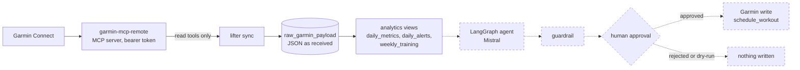
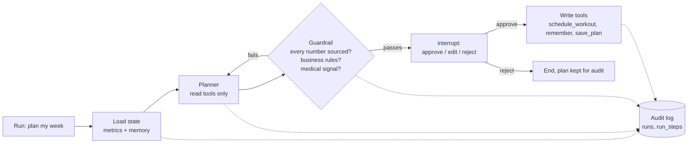

# Lifter

[](https://github.com/gabrielkpo/lifter/actions/workflows/ci.yml)
[](LICENSE)

A training coach agent for athletes who wear a Garmin watch, built on **LangGraph + Mistral** and
the **Model Context Protocol (MCP)**: it reads the athlete's data, analyses recovery and load,
proposes a weekly plan and writes nothing to Garmin without **human approval**.

> **Status: step 1 of 10 done, built in public.** The data layer works (Garmin sync and
> documented metrics); the agent comes next. See [Status / Roadmap](#status--roadmap).
> Expect breaking changes until `v0.1.0`.

## Why
A Garmin watch records hundreds of measures a day (heart rate, heart rate variability, sleep,
training load), but turning them into a decision ("what do I do this week?") still takes a
coach. Lifter combines the watch's data with what the watch is not told (injuries, preferred
exercises, weekly availability), proposes the week, and cites only values it can trace back to
a documented metric.

## How it works
Data path, from the watch to a proposed plan (solid: built; dashed: planned, step 2 onwards):



Target agent loop (steps 2 to 8):



Choices and their trade-offs:
- **Raw layer first.** Every MCP answer is stored as received, so metrics can be rebuilt without
  calling Garmin again, at the cost of disk space.
- **Plain SQL views rather than dbt.** Fewer moving parts and every line is readable; the views
  are pinned by tests with hand-computed cases instead of dbt tests. They live in an `analytics`
  schema recreated whenever `views.sql` changes, so a view change needs no migration.
- **Agents read numbers, they never compute them.** Every metric is defined once in
  [docs/metrics.md](docs/metrics.md); the guardrail will check each number the agent cites
  against those values, and business rules (no hard session on low recovery, weekly load
  increase of 10 % at most) run as code, not as prompt text.
- **Deletions are confirmed, not guessed.** An activity missing from a listing is dropped only
  when Garmin answers "not found" for it, so a paging shift never deletes a real session.
- **Sports science as sourced notes rather than retrieval.** Principles (periodisation, 80/20
  intensity, deload weeks, return after injury) will be short notes in our own words with their
  sources; their numeric rules become tested guardrail rules.

## Example
`lifter metrics --days 14` on 56 days of **synthetic** data with a hard last week, not real
data (regenerate it with [scripts/readme_example.py](scripts/readme_example.py)), last 10 rows:

```
day         load  acute_load_7d  chronic_load_28d  acwr  hrv_delta_pct  rhr_delta_bpm  sleep_hours  recovery_score  recovery_status  trend
2026-09-18  0     465.0          431.3             1.08  3.1            -1.2           7.93         72              good             stable
2026-09-19  75    420.0          427.5             0.98  0.5            -1.2           7.68         68              normal           stable
2026-09-20  75    405.0          435.0             0.93  -4.6           -1.1           7.70         63              normal           stable
2026-09-21  0     405.0          435.0             0.93  0.3            -1.1           6.65         56              normal           stable
2026-09-22  150   495.0          450.0             1.10  1.6            -1.0           7.14         62              normal           stable
2026-09-23  110   530.0          458.8             1.16  1.8            -1.0           6.57         56              normal           stable
2026-09-24  130   540.0          472.5             1.14  -20.1          1.0            8.08         47              normal           improving
2026-09-25  130   670.0          505.0             1.33  -6.5           3.0            7.09         41              normal           improving
2026-09-26  110   705.0          502.5             1.40  -22.4          2.9            7.36         33              low              fatigue
2026-09-27  130   760.0          505.0             1.50  -3.6           2.8            7.42         48              normal           fatigue
```

On 26 September, HRV is 22 % under the athlete's baseline (`hrv_drop` alert), recovery is `low`
and the trend turns to `fatigue`: the planner must propose a lighter week. From step 2, this
section will also show the plan proposed in dry-run.

## Status / Roadmap
Each step lands as a reviewed pull request with green CI.

| # | Step | Status |
|---|---|---|
| 1 | Garmin sync into Postgres, metric definitions, tests on synthetic data | ✅ Done |
| 1 bis | Wider sync: full sleep, Body Battery, training readiness, stress, VO2max, Garmin's own load | ⏳ Next |
| 2 | Single agent (LangGraph + Mistral): read tools, structured output, guardrail, dry-run; release `v0.1.0` | Planned |
| 3 | Athlete profile and long-term memory (goals, injuries, exercises, habits, feedback), `remember` tool | Planned |
| 4 | Human in the loop: pause before any write, approve / edit / reject in a Next.js UI over FastAPI | Planned |
| 5 | Audit log of every node and tool call, with an audit page | Planned |
| 6 | Multi-agent graph (recovery analyst, load analyst, planner, guardrail, writer) | Planned |
| 7 | Evaluation bench, single agent vs multi-agent | Planned |
| 8 | Approved writes to Garmin (`schedule_workout`), outside dry-run only | Planned |
| 9 | Private deployment behind authentication, CI/CD and monitoring | Planned |
| 10 | Results write-up | Planned |

**Evaluation plan** (written before any run):
- **Bench**: 20 to 40 synthetic weeks covering overload, low recovery, return after injury, a
  normal week and a race goal, each with its expected outcome written first (for example "must
  propose a lighter week", "must refuse an intense plan").
- **Measures**: constraint violations, accuracy of every cited number, plan quality (graded by
  hand), tokens, latency, variance over 3 runs.
- **Decision rule** for the multi-agent graph: kept only if it has **no constraint violation**,
  cites numbers **at least as accurately** as the single agent, and costs **at most 2×** its
  tokens. Otherwise the single agent ships and this README reports the negative result.

## Run it
Needs [uv](https://docs.astral.sh/uv/) (it installs Python 3.12 if missing), a local Postgres 17
and a running [garmin-mcp-remote](https://github.com/gabrielkpo/garmin-mcp-remote), reached on the
loopback or a private network; its bearer token goes in `.env`. Besides Python and its packages,
nothing is downloaded.

```bash
cp .env.example .env               # then set GARMIN_MCP_TOKEN
createdb lifter
uv sync
uv run lifter sync --days 90       # creates or updates the schema, then syncs (read-only)
uv run lifter metrics --days 14
```

Days already stored are not fetched again, except the last 3 (Garmin completes them late);
`lifter sync --refresh` refetches the whole range. A failed call is logged and the sync goes on;
it stops after 5 failures in a row.

## Project structure
| Path | Content |
|---|---|
| `src/lifter/cli.py` | `lifter migrate`, `lifter sync`, `lifter metrics` |
| `src/lifter/garmin.py` | MCP client with the read-only tool allowlist |
| `src/lifter/sync.py` | Garmin to raw layer, refetch window, deletion checks |
| `src/lifter/db.py`, `src/lifter/sql/` | Connection, numbered table migrations, `views.sql` (analytics schema) |
| `docs/metrics.md` | Every metric definition and threshold |
| `tests/` | pytest on synthetic data, against a throwaway Postgres database |
| `scripts/readme_example.py` | Regenerates the README example from synthetic data |

## Data and privacy
- **In the repository**: code, metric definitions and synthetic data only. `data/` and `.env`
  are ignored by Git; gitleaks scans every pull request and push to `main`.
- **Never in the repository**: the athlete's Garmin data, profile or plans. They stay in the
  local Postgres database.
- **Garmin access**: through the athlete's own MCP server, reached on the loopback or a private
  network and never exposed without authentication; Lifter's allowlist only permits read tools.
- **Sent to a third party**: today, nothing besides the calls to the athlete's own MCP server.
  From step 2, the agent sends the Mistral API the computed indicators it needs, never the raw
  Garmin series.
- **No medical advice**: unusual signals raise `critical` alerts
  ([docs/metrics.md](docs/metrics.md)); the guardrail will use them to block intense plans and
  point to a health professional.

## Limitations / next
- Thresholds are version 1: training heuristics for one athlete, not medical criteria; they will
  be tuned with the bench.
- Load is Lifter's own rolling sums (7 and 28 days), not Garmin's exponentially weighted values;
  step 1 bis stores Garmin's figures to compare them.
- Baselines need 14 measured nights and the load ratio 28 days of history: a new athlete gets
  no recovery score during the first two weeks.
- The sync runs on demand; daily scheduling is not automated yet.

## Development
```bash
uv sync --group dev
uv run pre-commit install                     # ruff (locked version) and gitleaks before each commit
uv run pytest                                 # needs a local Postgres (TEST_DATABASE_URL)
```
Pull requests use Conventional Commits titles; each one goes through a security review and a
code review before it is opened, and needs green tests, gitleaks and PR title checks (CodeQL
also runs on every PR). Releases
start at `v0.1.0`, at the end of step 2.

## License
[MIT](LICENSE)
